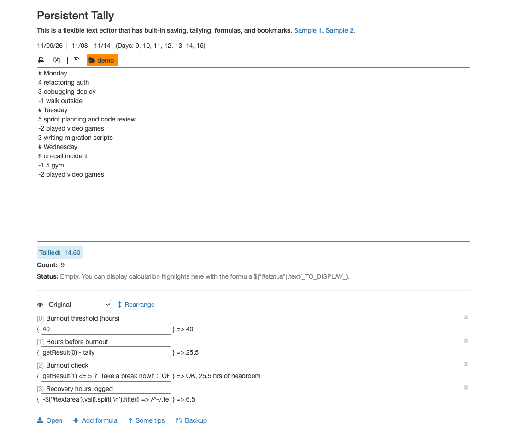
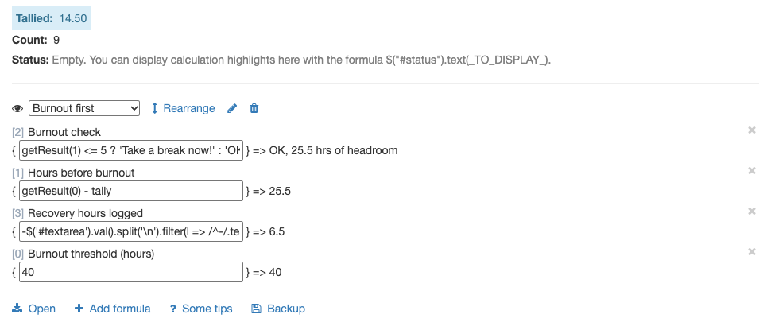
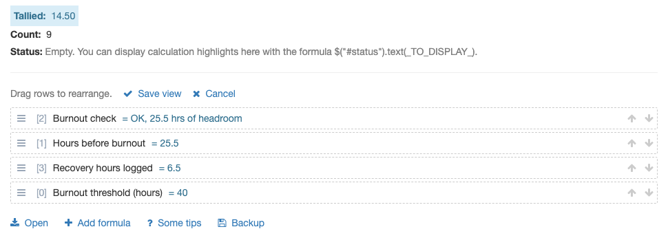

By Weng (Weng Fei Fung)

<a target="_blank" href="https://github.com/Siphon880gh" rel="nofollow"></a>
<a target="_blank" href="https://www.linkedin.com/in/weng-fung/" rel="nofollow"></a>
<a target="_blank" href="https://www.youtube.com/@WengTeachesCode/" rel="nofollow"></a>

# Persistent Tally

A plain-text notepad that auto-saves and keeps a running total of every line that starts with a number. It's great for when you gotta tally things over weeks or months.



## Use cases

- **Workout logs:** pushups, reps, sets or minutes per session, with weekly progress toward a goal
- **Workout and diet plans:** plans you check off and total up over a season
- **Supplements and habits:** doses, cups of water, or days a habit was done
- **Sleep:** hours slept per night and your average
- **Budgets and balances:** spending or payments you subtract from a starting balance
- **Hours and time tracking:** hours worked or earned, and how much time you have left

## Features

- **Auto-saving tally files:** each tally is its own file. Name it with the save icon, switch files with the folder icon, or open one by URL (`?open=filename`).
- **Running tally:** every line that starts with a number (or simple math like `1/2`) is added to **Tallied**, and **Count** shows how many lines were counted.
- **Formulas:** click **Add formula** to add a row with a description and a JavaScript expression in `{ }`. Use `tally` and `counter`, and reference another formula's result with `getResult(X)`, where `X` is the `[index]` shown next to it.
- **Saved formula views:** click **Rearrange**, drag formulas into the order you want, then **Save view**. Switch views from the dropdown, or rename and delete them. A view only changes the display order, so the original order and the `getResult(X)` indices never change.
- **Bookmarks:** jump to lines that start with a token you choose, like `#` for weekly headings.
- **Find text:** search the notes and jump between matches.
- **Notes, Status and per-line code:** two notes boxes, a Status line a formula can write to, and optional JavaScript that runs before each tallied line or after all lines.
- **Backup:** download the current file as a dated JSON backup. Print and copy buttons are at the top of the notes.

| Saved view (custom order) | Rearrange mode |
| --- | --- |
|  |  |

## Run it

1. Serve the folder with PHP, for example by putting it under MAMP's document root, or with `php -S localhost:8000` from the repo folder.
2. Create the data folder. It's gitignored so your tallies stay local:
   ```
   mkdir data
   ```
3. Open `index.php` in your browser, type a few lines, and click the save icon to name your tally.
